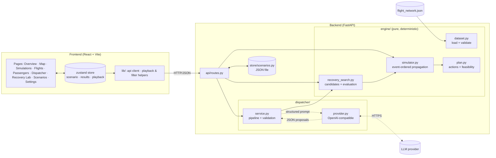

# ARCHITECTURE — Domino Sky

## System architecture



**Component relationships**
- The engine depends only on Pydantic models. The dispatcher depends on the engine. The API depends on both. The frontend talks only to the API.
- `Network` (an indexed dataset) is loaded once, cached (`api/deps.get_network`), and validated at startup. Failures are logged and exposed at `/api/validation`.

## Data flow

1. The UI edits a `ScenarioInput {disruptions, actions, settings}` in the store. Nothing is computed on the client.
2. `POST /api/simulate` runs the engine three times: **baseline** (no disruptions or actions), **disrupted** (disruptions only) and **recovered** (with actions, only if there are any). It returns all three plus a comparison.
3. The UI renders KPIs, the map, the Gantt chart, tables and the event log from those results. Playback only interpolates between the engine's actual departure and arrival times.
4. Recovery: `POST /api/recovery/evaluate` (preview) and then appending the action to the scenario and re-running `/simulate`. If the engine reports `applied=false`, the store removes the action again.
5. Dispatcher: `POST /api/dispatcher/recommend` → simulate → enumerate and evaluate candidates → LLM or rule engine → validation → response.

## Simulation engine

### Time
Integer minutes from midnight IST (`timeutil.py`). A clock arrival earlier than its departure is moved to the next day (+1440). Delays may push times past 1440. The formatter shows these as `HH:MM +1`.

### Operating plan (`plan.py`)
`base_plan` takes each tail's legs from the dataset, ordered by `leg_order`. Actions are then applied **in order**, and each is checked first:

| Action | Feasibility checks | Effect |
|---|---|---|
| `cancel_flights` | flights exist and are not already cancelled; warns about the out-of-position cascade (static walk) | marks legs cancelled |
| `deploy_spare` | is a spare; not already deployed (no overlap); the replaced tail is active and the leg is on it and not cancelled; seats ≥ pax; positioning route exists (Dijkstra over dataset city pairs, minimum block times, 30-minute intermediate turns); standby-crew assumption enabled; assumed crew's scheduled duty ≤ limit | the spare gets ferry legs plus the replaced tail's legs from `from_flight` onward |
| `swap_aircraft` | both legs active, on different tails, same origin; both crews' scheduled duty on their new rotations ≤ limit | the two tails exchange remaining legs (crews stay with their aircraft) |
| `protect_connection` | connection exists; legs not cancelled; one hold per outbound | the outbound may wait up to `max_hold_min` |

### Disruption models (`simulator.build_windows`)
Every disruption becomes a time window `[start, start+duration)` at one airport:

| Type | Model |
|---|---|
| airport_closure | effective capacity 0 (arrivals and departures) — **fully modelled** |
| capacity_reduction | effective hourly capacity = ⌊capacity_per_hour × (100 − pct)/100⌋ — **fully modelled** |
| thunderstorm | capacity reduction with user severity (default 100% = closure) |
| runway_blockage | capacity reduction (default 50%; 100% = runway closed) |
| airspace_restriction | capacity reduction applied to **arrivals only** |
| ground_handling | no capacity change; turnarounds whose inbound arrives in the window need 30 + `extra_turnaround_min` |

### Core algorithm (`simulator.simulate`)
Event-ordered single pass over all aircraft:

```
loop:
  for each tail (sorted): skip legs that are cancelled or out of position
      (origin ≠ aircraft location → cancelled "out of position", linked to the cancellation that caused it)
  candidates = next leg of each tail with
      ready = max(sched_dep, prev_actual_arr + 30 [+ ground-handling extra])     # rotation constraint
      (spares: ready ≥ available_from)
  pick the candidate with min (ready, sched_dep, leg_id)                           # chronological, deterministic
  dep = SlotBook.find(origin, ready, "dep")                                         # closures/capacity
  if protected connection: hold dep until inbound_arr + MCT if within max_hold
  repeat:
      arr = SlotBook.find(dest, dep + block, "arr")
      if arr == dep + block: break
      if the restricting window started after dep → airborne hold (arr stays later, dep unchanged)
      else → ground delay: dep = SlotBook.find(origin, arr − block, "dep")
  book both slots; record components; aircraft location = dest
```

`SlotBook.find` moves a movement to the end of a zero-capacity window, or to the next clock hour when the hour's (reduced) capacity is used up. Block time is always the scheduled `block_minutes`. Ferries use the same rules.

**Invariants (tested):** actual dep ≥ scheduled dep; actual dep ≥ previous actual arr + 30; no departures or arrivals inside a closure window; capacity per restricted hour is never exceeded; identical inputs give identical output.

### Derived analyses
- **Explainability:** each flight gets `components[]` (`rotation`, `departure_restriction`, `arrival_ground_delay`, `airborne_hold`, `ground_handling`, `connection_hold`, `spare_positioning`) with minutes, detail, source flight and disruption id. It also gets `primary_reason` (the largest component), `root_cause` (followed through rotation parents), `inherited_delay` (rotation part), `introduced_delay` (`arr_delay − inherited`) and `delay_parents`.
- **Connections:** made / missed / inbound_cancelled / outbound_cancelled using actual times and `min_connect_minutes`. The passenger count is the connection's own `passengers`.
- **Crew:** each crew follows its aircraft. Duty = last operated actual arrival − `duty_start`. A violation is attributed to the final flight and its root cause.
- **Capacity:** per airport-hour, scheduled vs actual movements vs effective capacity, with a `scheduled_overload` flag.
- **Events:** sorted `(timestamp, kind order, flight, airport)` and numbered `E0001…`. Kinds: DISRUPTION_START/END, DELAY_ASSIGNED, DEPARTED, ARRIVED, CANCELLED, CANCELLATION_DECISION, CONNECTION_MISSED, CONNECTION_PROTECTED, CREW_DUTY_VIOLATION, SPARE_DEPLOYED, AIRCRAFT_SWAP, FERRY_DEPARTED/ARRIVED.
- **KPIs:** see `models.KPIs`. Impact index and health are defined in SCOPE.md (A8, A10). Network recovery % = (impact_disrupted − impact_recovered) / (impact_disrupted − impact_baseline).

## Recovery engine (`recovery_search.py`)
`generate_candidates` deterministically enumerates:
1. each available spare × each disrupted leg of each active tail,
2. round-trip pair cancellations and final-leg cancellations of disrupted legs,
3. swaps between a disrupted leg and a less-delayed leg from the same origin within ±120 min,
4. protection (60-min hold) for every missed connection.

`evaluate_action` simulates the scenario with the action appended and returns feasibility checks, flights changed, an `ImpactDelta` and trade-offs (flights whose delay increases, new cancellations, new crew violations, spare consumption). `rank_candidates` keeps feasible candidates with a positive impact reduction, sorted by impact reduction (ties broken by id).

## AI dispatcher (`dispatcher/service.py`)
```
simulate → rank_candidates → context (KPIs, delayed flights, broken connections, crew violations,
           spares availability, restrictions, top-N candidates with engine impact)
  ├─ LLM configured:   provider.complete_json(system, context) →
  │      for each item: candidate_id ∈ shortlist → use engine evaluation
  │                     or action → parse_action → evaluate_action (must be feasible and improving)
  │                     reject unknown ids, malformed actions, spare double-booking
  │      narrative numbers not present in context → unverified_numbers
  │      on LLMError → fall through to the rule engine (provider_error reported)
  └─ rule engine: best candidate per category, then by impact (no spare reused), templated reasons
     built from engine values
```
The response includes `source` (`llm` or `rule_based`), crew alerts and priority flights (pax × delay). The UI labels the source on every card.

## API contracts
Summary (full details in [docs/API.md](docs/API.md)):

| Method | Path | Body → Response |
|---|---|---|
| GET | /api/health | → `{status, dataset_checksum}` |
| GET | /api/network | → dataset + `dep_min/arr_min`, rotations, routes, positioning graph |
| GET | /api/validation | → `ValidationReport` |
| GET | /api/model | → engine parameters + LLM status |
| GET | /api/presets | → scenario templates (inputs only) |
| POST | /api/simulate | `ScenarioInput` → `{baseline, disrupted, recovered?, comparison}` |
| POST | /api/recovery/evaluate | `{scenario, action}` → `EvaluatedAction` |
| POST | /api/recovery/candidates | `ScenarioInput` → `EvaluatedAction[]` (top 30) |
| POST | /api/dispatcher/recommend | `ScenarioInput` → `DispatcherResponse` |
| GET/POST | /api/scenarios | list / create |
| GET/PUT/DELETE | /api/scenarios/{id} | read / update / delete |
| POST | /api/scenarios/{id}/duplicate | → copy |
| POST | /api/export | `{name, scenario, format: json|csv}` → file |
