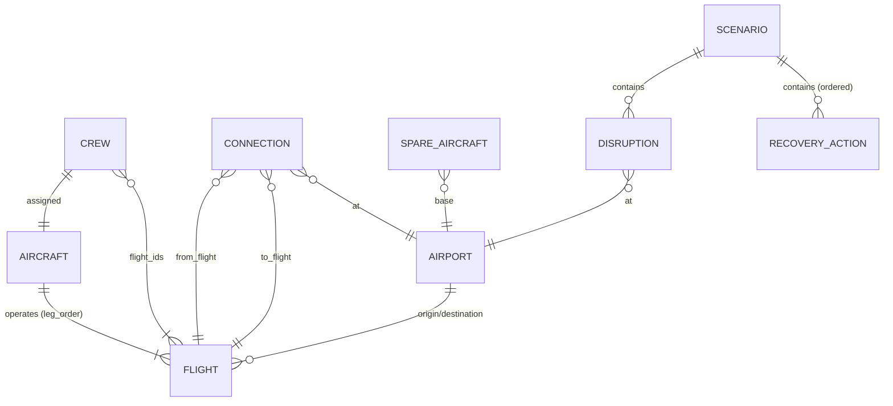

# DATABASE — Domino Sky

## Decision: no database for the MVP
The dataset is a small, read-only JSON document (~21 KB) that is fully loaded and indexed in memory; simulations are pure functions of `(dataset, scenario)` and are recomputed on demand in milliseconds. The only mutable data is user scenarios, which are small documents. A JSON file with atomic writes (`tmp` + `replace`) and a process lock is sufficient and keeps the prototype dependency-free. Results are **never persisted** — they are always recomputed so they cannot drift from the engine.

## Data entities
| Entity | Key | Source |
|---|---|---|
| Airport | `id` (IATA) | dataset |
| Flight | `flight_id` | dataset |
| Aircraft (active) | `tail_id` VT-DS01…16 | derived from flights |
| Spare aircraft | `tail_id` VT-DS17/18 | dataset `spare_aircraft` |
| Crew group | `crew_id` | dataset |
| Connection | `connection_id` | dataset |
| Scenario | `id` (12-hex) | user, `scenarios.json` |
| Disruption, RecoveryAction | within Scenario | user |
| SimulationResult (flights, connections, crews, aircraft, airports, capacity, events, KPIs) | derived | engine (not stored) |

## Relationships


## Data structures
- Engine index `Network`: `airports`, `flights`, `times` (dep/arr minutes, midnight-resolved), `rotations` (tail → ordered flight ids), `connections`, `crews`, `crew_by_tail`, `spares`, `checksum`.
- Scenario document (`StoredScenario`):
```json
{ "id": "a1b2c3d4e5f6", "name": "Mumbai storm", "description": "",
  "disruptions": [{"id":"D1","airport":"BOM","type":"airport_closure","start":"08:00","duration_min":90,
                   "capacity_reduction_pct":100,"extra_turnaround_min":0,"description":""}],
  "actions": [{"type":"deploy_spare","spare_tail":"VT-DS18","replace_tail":"VT-DS12","from_flight":"DS1203"}],
  "settings": {"assume_standby_crew_for_spares": true},
  "created_at": "2026-11-20T06:00:00+00:00", "updated_at": "…" }
```

## Storage strategy & persistence decisions
- `DATASET_PATH` (read-only) and `SCENARIO_STORE_PATH` (read/write) are configurable.
- Client-side state (current draft, strategy snapshots, playback) lives in memory; saving is explicit.
- Docker compose mounts a named volume for scenarios.
- **Scaling path:** for multiple instances or serverless hosts, replace `ScenarioStore` with a PostgreSQL/SQLite implementation of the same five methods (`list/get/create/update/delete/duplicate`); a `scenarios(id PK, name, description, payload JSONB, created_at, updated_at)` table suffices.
