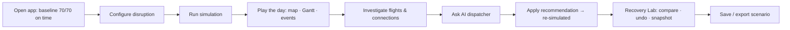

# USER_FLOWS — Domino Sky

## Main user journey

## 1. Creating a disruption
1. **Simulations** → *Disruption configuration* (opens a blank form when none exist) or **Add disruption**.
2. Select airport (e.g. BOM), type (Airport closure), start `08:00`, duration `90`; for capacity types use the severity slider (shows `capacity → reduced movements/hour`); optional description.
3. **Add disruption** — validation blocks bad airports, `HH:MM` outside 00:00–23:59, duration outside 5–1440, severity out of range.
4. Edit (pencil) or remove (trash) any disruption; the top bar shows “Inputs changed — run to update”.
Shortcut: Overview quick-start buttons or the scenario selector load templates (inputs only).

## 2. Running a simulation
Click **Run simulation** (top bar or panel). The engine returns baseline, disrupted and (if actions exist) recovered results; KPIs, network status and every page update. **Reset to baseline** clears disruptions and actions.

## 3. Investigating cascading delays
- **Playback**: play / pause / step to previous/next event / reset / speed (1–32 simulated min/s). Map airport states (normal, disrupted, closed, congested, recovery) and aircraft icons move with the clock; Gantt cursor and event log stay in sync.
- **Event log**: click an event to jump to its time and open the flight.
- **Flight Operations**: filter (delayed, severe, cancelled, aircraft, airport, search), sort, click a row → **Flight inspector**: times, delay components with sources, root cause, causal graph (backward causes → forward consequences), aircraft rotation timeline, connections.
- **Network Map**: click an airport for capacity use, movements and affected passengers; click a route for its flights.
- **Passenger Impact**: connection table with actual connect time vs MCT and the reason for each failure.

## 4. Using the AI dispatcher
1. **AI Dispatcher** → *Get recovery recommendations*.
2. Read the situation assessment; the badge says **LLM-generated · model** or **Rule-based fallback engine**.
3. Each card shows action, reason (labelled LLM or rule engine), engine-computed impact (delay reduction, passengers protected, missed-connection pax, delayed flights, crew violations, impact index), flights affected, trade-offs, risks, feasibility checks and status.
4. Side panels: crew duty violations and recovery priority flights.

## 5. Applying a recovery strategy
- From a card: **Apply & re-simulate**. Or in **Recovery Lab** build an action (Deploy spare / Cancel / Reassign aircraft / Protect connection) → **Check feasibility & impact** → **Apply**.
- Infeasible actions show failed checks and cannot be applied; if the engine rejects an action at apply time it is removed automatically with a message.
- Applied plan lists actions in order with outcomes; **Undo last**, remove any, or **Clear all**.

## 6. Comparing before and after
- Top-bar view switch: Baseline / Disrupted / Recovered (every page follows it).
- Recovery Lab: network recovery %, delay-minutes recovered %, metric table (baseline · disrupted · recovered) and chart.
- **Snapshot** a plan as a strategy, try another, compare in the strategy table, **Load** the best.
- **Scenario History**: save scenarios, select ≥2 and **Compare** (each re-simulated), export JSON (full results) or CSV (flights).
